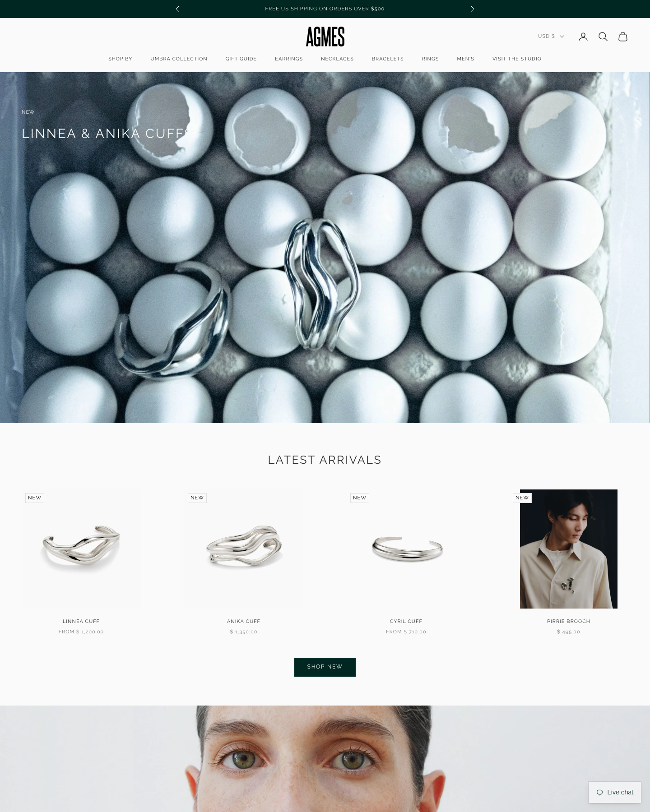
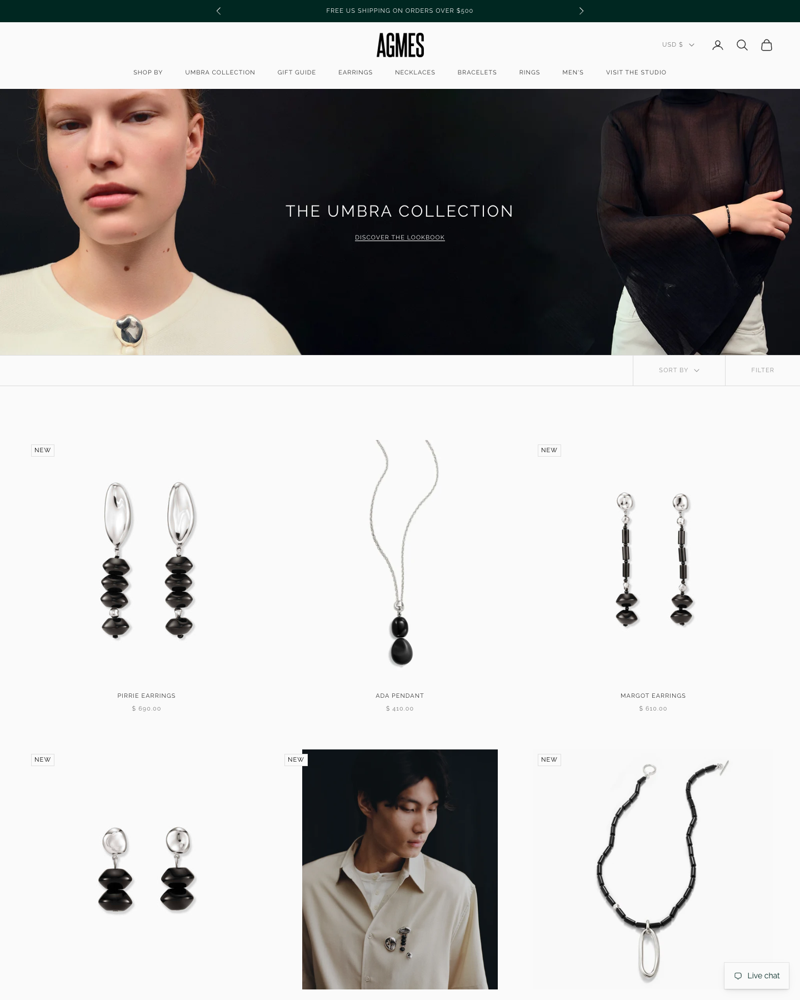
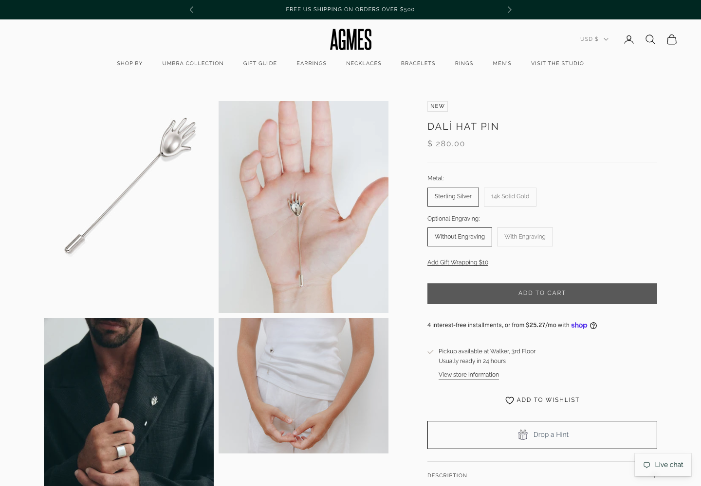
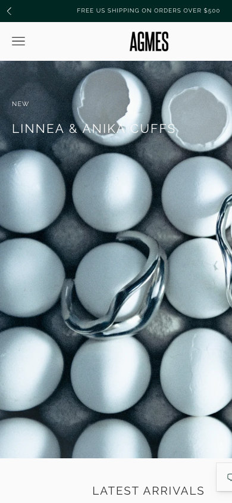

# AGMES: design reference

https://agmesnyc.com · New York (Tribeca studio) · recycled sterling silver, gold vermeil, 14k gold
Captured 2026-10-26. Built on Shopify's **Prestige** theme (v10.10), a paid off-the-shelf theme, with custom colors and fonts.

**In one line:** a clean, bright catalog with named pieces, product photos on a light grey background, and one deep green accent. Warmer and more practical than Sophie Buhai.

| Desktop home | Shop grid | Product page | Mobile |
|---|---|---|---|
|  |  |  |  |

---

## 1. Design tokens

### Color
Pulled from the theme settings.

| Role | Value | Notes |
|---|---|---|
| Background | `#FAFAFA` | Off-white, slightly softer than pure white |
| Product image background | `#F9F9F9` | Matches the page, so products look like they're floating |
| Text | `#303030` | Soft black |
| Accent (announcement bar, main buttons) | `#002721` | Very dark green. The only color on the site |
| Secondary button | `#595959` | Grey "Add to cart" on the product page |
| Borders | `#DCDCDC` | Variant buttons, dividers |
| Warm section background | `#FCF6F1` with `#474541` | Used for some content blocks |

### Typography
- **One family: Raleway** (free Google font), regular 400 weight.
- **Logo:** a separate tall, condensed, bold sans wordmark. It's the only heavy type on the site.
- **Headings:** UPPERCASE, letter-spacing `0.1em`, light weight. "LATEST ARRIVALS" is about 28px.
- **Body:** 12px base, 14px large. Small for body text.
- **Buttons:** UPPERCASE, 12px, letter-spacing `0.15em`.
- **Prices:** uppercase with wide spacing and cents shown: `FROM $ 1,200.00`.

### Shapes, spacing and motion
- Square corners on all buttons and inputs (radius 0).
- Shadows are almost invisible (5% opacity).
- Content max width 1360px, gutter 20px, 40px between sections.
- Transitions are quick: 0.2s on image transforms and opacity, 0.3s on underline animations.

---

## 2. Header and navigation

```
                    ‹  FREE US SHIPPING ON ORDERS OVER $500  ›                   (dark green bar)
                                      AGMES                       USD $  [acct] [search] [bag]
SHOP BY  UMBRA COLLECTION  GIFT GUIDE  EARRINGS  NECKLACES  BRACELETS  RINGS  MEN'S  VISIT THE STUDIO
```
- **Announcement bar:** dark green `#002721`, with rotating messages and arrows (free shipping, book a studio visit).
- **Two rows:** logo centered with icons on the right, then a centered row of 9 uppercase links below.
- Icons (line style) for account, search and bag. Currency picker.
- **Shop By** opens a large mega menu: New, Collections (10 named collections), Lookbooks, Wedding, Brooches, Sets, Stones, Pearls, Engravable, Objects, Accessories, All.
- **"Visit the Studio"** is a main nav item, which makes it feel like a real place.
- **Mobile:** announcement bar, then hamburger on the left and logo centered. Icons move into the menu.
- A floating "Live chat" button sits bottom right on every page.

---

## 3. Landing page

1. **Hero carousel:** full-width images about 780px tall, rotating through 3 slides:
   - Product launch: "NEW" kicker + "LINNEA & ANIKA CUFFS" in white uppercase, top left over the photo.
   - Men's: "Cyril Cuff".
   - A Sydney city guide.
   - The hero photo is a striking still life: silver cuffs sitting in an egg carton, shot in cool blue-grey tones.
2. **Latest Arrivals:** centered uppercase heading, a row of 4 product cards, then a dark green `SHOP NEW` button.
3. **Full-width editorial image:** close crop of a face (earrings).
4. **Fall Arrivals:** a second row of product cards.
5. **Category tiles:** Men's, Necklaces, Rings, each a lifestyle image with a label.
6. **Style Focus:** one product, with the headline "A new statement." and a `DISCOVER THE PIRRIE EARRINGS` button.
7. **Visit / book:** "Shop In Person or Virtually", walk-in hours.
8. **Instagram feed** (via an app).
9. **Newsletter:** 10% off your first order.
10. **Footer.**

The homepage alternates **a product row, then a full-width photo**, which keeps it from feeling like a grid of products.

---

## 4. Shop (collection) page

- **Banner:** full-width image about 480px tall with the collection name in white uppercase, centered, and an underlined `DISCOVER THE LOOKBOOK` link.
- **Toolbar:** a thin bar under the banner with `SORT BY ⌄` and `FILTER` on the right, separated by vertical hairlines.
- **Filters** (slide-out panel): Category, Metal, Stone, Earring Style, Drop Length, Necklace Style, Ring Size, Price, Availability. Each option shows a count.
- **Grid:** 3 columns desktop, 2 mobile. No paging on a 26-item collection; everything loads at once.

### Product card
```
┌ NEW ─────────────────┐
│                      │
│   product on #F9F9F9 │
│   (hover: 2nd image) │
│                      │
└──────────────────────┘
       PIRRIE EARRINGS
          $ 690.00
```
- Square-ish image. Product shot on light grey, with an on-model shot on hover.
- Small outlined `NEW` badge, top left.
- Name centered, UPPERCASE, letter-spaced, about 11px.
- Price centered underneath in grey, with cents. `FROM $ 720.00` for pieces with options.
- The grid mixes in occasional on-model photos (the brooch on a shirt) as the main image, which breaks up the rhythm.
- Some theme versions show `Add to cart` / `Choose options` under the card. The current site hides them.

---

## 5. Product page

```
┌──────────┬──────────┐   NEW
│ product  │ in hand  │   DALÍ HAT PIN
│          │          │   $ 280.00
├──────────┼──────────┤   ─────────────────────────
│ on model │ on model │   Metal:  [Sterling Silver] [14k Solid Gold]
│          │          │   Optional Engraving:  [Without] [With]
└──────────┴──────────┘   Add Gift Wrapping $10
                          [        ADD TO CART        ]
                          4 interest-free installments… shop
                          ✓ Pickup available at Walker, 3rd Floor
                          ♡ ADD TO WISHLIST
                          [   🎁 Drop a Hint   ]
                          DESCRIPTION  +
                          CARE  +
                          SHIPPING & RETURNS  +
```
- **Images:** a 2-column grid of all images (6 on this product). The first shows the product on light grey, the rest are in-hand and on-model. Click to zoom.
- **Info column (sticky):**
  - Name in UPPERCASE, about 22px, letter-spaced.
  - Price in grey with cents.
  - **Options as outlined buttons**, not dropdowns. The selected one has a dark border, unavailable ones are greyed.
  - Engraving: extra fields appear for text (up to 10 characters) and font (Sans, Script, Cursive).
  - `Add Gift Wrapping $10` as an underlined link.
  - `ADD TO CART`: full-width, grey `#595959`, square, uppercase, spaced. It repeats in a sticky bar when you scroll past it.
  - Shop Pay installments line.
  - In-store pickup availability.
  - Wishlist and "Drop a Hint" (sends the piece to someone by email).
- **Accordions:** Description, Care, Shipping & Returns, plus "About the [Name] Collection".
  - Description is short: 1–2 sentences, then a list: material, size ("Measures 3.25" long"), clasp, "Handmade in NYC".
  - Shipping spells out the policy: ships Mon–Fri via UPS/DHL, free over $500, NYC pickup, returns within 10 days.

---

## 6. Cart

- Slide-out drawer from the right, titled "Cart".
- Empty state: "Your cart is empty".
- Items, subtotal, checkout button. Gift wrapping is added from the product page, not the cart.
- No upsells or free-shipping progress bar in the drawer. The free-shipping message lives only in the announcement bar.

## 7. Checkout

Standard Shopify checkout. Payment: Shop Pay, Apple Pay, PayPal, all major cards. Shop Pay installments. Local pickup at the Tribeca studio as a delivery option.

## 8. About / studio

- "Visit the Studio" page: studio address, walk-in hours (Mon–Fri 10–5), a booking link for in-person or virtual appointments.
- Brand copy is plain and factual: when it was founded, where, and that it uses recycled metals. No long story.

---

## 9. For Liv: take and skip

### Take
| Element | How it adapts to 12 pieces |
|---|---|
| Named pieces (Pirrie, Margot, Ada) | Every Liv piece gets a name plus a number: `No. 04 Halo` |
| Product shots on a background that matches the page | Shoot on our bone color so the grid looks seamless |
| On-model photo on hover | Every card: still life first, on-body on hover |
| A single dark accent color | One accent, used only on the primary button. Pick a deep color that suits the brand (ink, oxblood or dark green) |
| Options as outlined buttons | Metal, ring size and chain length as buttons |
| Gift wrapping as a $ add-on | Same, on the product page or in the cart |
| Clear accordion content: Description, Care, Shipping & Returns | Use exactly these three, plus Details |
| Shipping policy written out on the product page | Short, specific lines |
| Product row, then full-width photo, repeated | Our homepage rhythm |
| "Style Focus": one piece, one line, one button | Our homepage spotlight block |
| Sticky add-to-cart bar on scroll | On mobile only |

### Skip
- The announcement bar. It's a store signal, not a showroom one. Put free shipping on the product page instead.
- 9-item nav and the "Shop By" mega menu.
- Hero carousel. Use one image or film.
- 9 filter groups. We need none, or 4 text tabs at most.
- Raleway. It reads generic. The serif + small sans pairing in our brief is more distinctive.
- Prices with cents (`$ 690.00`). Use `$690`.
- Wishlist, Drop a Hint, live chat widget, Instagram feed app. Unneeded at our size.
- The grey add-to-cart button. It looks disabled. Our main button should be the darkest thing on the page.

---

## Sophie Buhai and AGMES side by side

| | Sophie Buhai | AGMES | Liv (proposed) |
|---|---|---|---|
| Background | `#FFFFFF` | `#FAFAFA` | `#F4F1EC` bone |
| Text | `#222` | `#303030` | `#1A1918` ink |
| Accent | none | `#002721` green | one dark accent, primary button only |
| Type | Univers, 12px, one family | Raleway, uppercase headings | Serif names + small sans UI |
| Nav | 5 text links, text cart | 9 links + icons + promo bar | 3 text links, `Bag (0)` |
| Hero | One image, no text | Carousel with text | One image or film, no text |
| Grid | 2 columns, narrow, centered | 3 columns, full width | 3 columns, narrower than full width |
| Card | Name left, price right | Name and price centered, uppercase | `No. 04 · Halo` left, `$640` right |
| Card photo | Alternates on-model and still life | Product on grey, on-model on hover | Still life on bone, on-body on hover |
| Product page | 3 columns, thumbnails left | 2-column image grid + sticky info | 2-column image grid + sticky info |
| Add to cart | Black bar with price inside | Grey, uppercase | Ink bar with price inside |
| Options | Not shown | Outlined buttons | Outlined buttons |
| Gift wrap | Checkbox in cart | $10 link on product page | Checkbox in cart |
| Checkout | Shopify | Shopify | Shopify |
