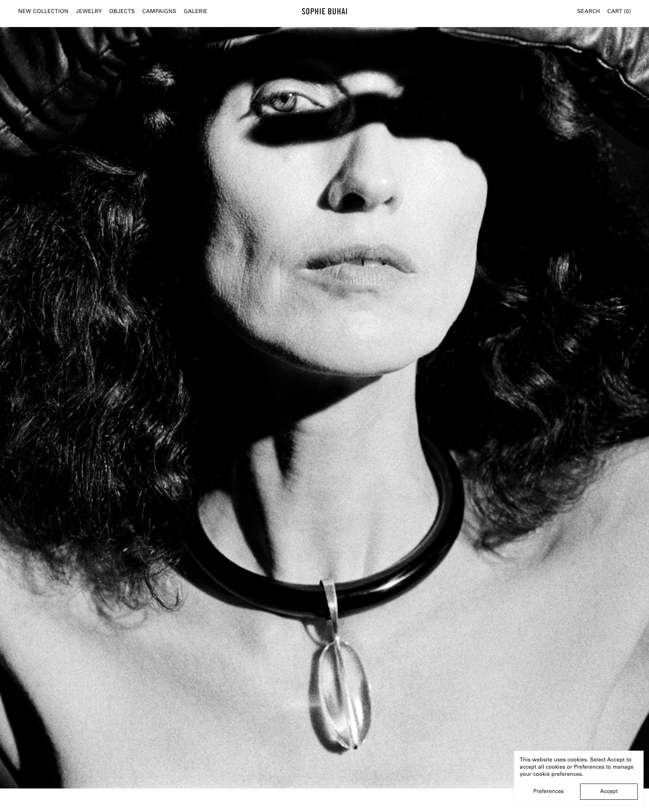
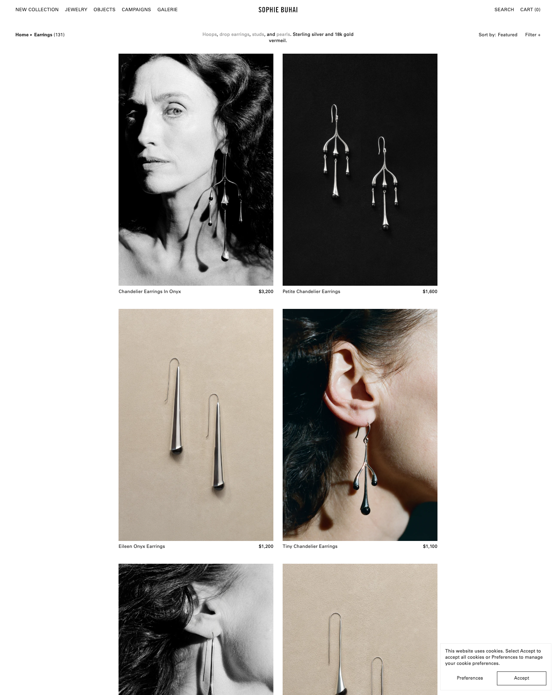
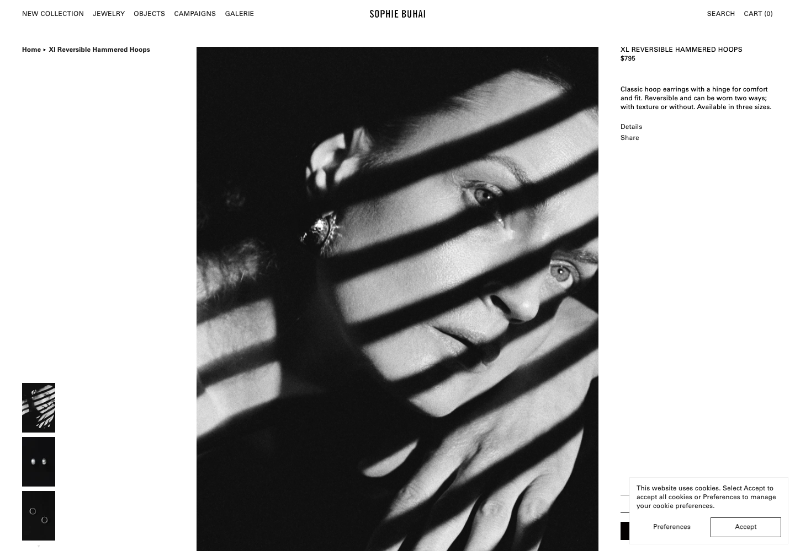
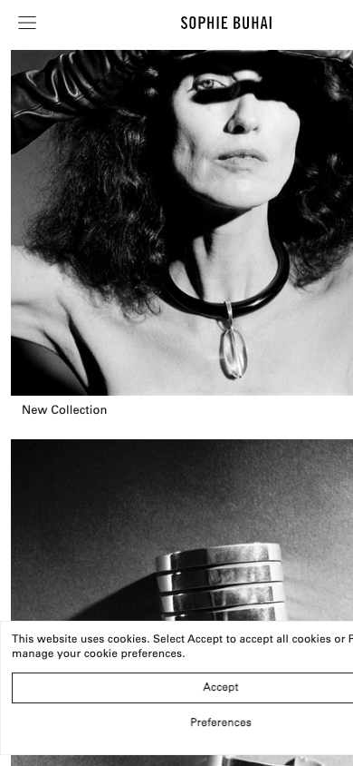

# Sophie Buhai: design reference

https://www.sophiebuhai.com · Los Angeles · sterling silver, 18k gold vermeil, 18k gold, stones
Captured 2026-10-26. Built on Shopify with a custom theme (not a store template).

**In one line:** a black-and-white fashion editorial with a shop attached. Photos do almost all the work. The interface is small text in one typeface.

| Desktop home | Shop grid | Product page | Mobile |
|---|---|---|---|
|  |  |  |  |

---

## 1. Design tokens

### Color
Pulled from the site's stylesheet.

| Role | Value | Notes |
|---|---|---|
| Background | `#FFFFFF` | Pure white everywhere |
| Text / buttons | `#222222` | Near-black, never pure `#000` for text |
| Secondary text | `#999999` | Inactive links, e.g. the grey words in the category description |
| Dividers | `#EEEEEE` | Hairlines between cart rows |
| Photo backdrop (still life) | about `#C8BDAC` | Warm sand paper, in the photos, not the CSS |

There is no accent color. All color comes from the photos.

### Typography
- **One family: Univers LT Pro.** 55 Roman for everything, 65 Bold for breadcrumbs and emphasis.
- **Logo:** a separate condensed sans wordmark, uppercase, centered.
- **Sizes:** almost everything is **12–13px**. 16–18px appears only in a few spots. There are no large headlines anywhere on the site.
- **Case:** nav and product titles on the product page are UPPERCASE. Grid names and body copy are sentence/title case.
- **Letter-spacing:** `0.35px` on uppercase labels, `0.1px` on body text.

### Spacing and layout
- Header height: 60px desktop, 55px mobile. Side padding 36–40px desktop, 20–24px mobile.
- The shop grid is **narrow and centered**: 2 columns about 400px wide each with a 24px gap, leaving wide empty margins on both sides. This makes the catalog feel like a gallery wall instead of a store.
- Breakpoints: 1280, 1024, 860, 768, 600px.

### Motion
- `transition: all .3s` on almost every hover (link color, image swap).
- One slower `1.5s` fade used for large images loading in.
- No parallax, no carousels on the homepage, no scroll animation.

---

## 2. Header and navigation

```
NEW COLLECTION  JEWELRY  OBJECTS  CAMPAIGNS  GALERIE      SOPHIE BUHAI      SEARCH  CART (0)
```
- Fixed white bar, 60px tall. Links on the left, logo dead center, utilities on the right.
- **Everything is text.** No icons for search, account or cart. The cart is `CART (0)`.
- No account link and no announcement bar.
- Hovering **Jewelry** opens a mega menu with five columns of plain text links:
  - **Edits:** In Stock, Essentials, Exclusives
  - **Categories:** Earrings, Necklaces, Bracelets, Rings, Men's, Baby, Hair
  - **Materials:** 18k Gold, Pearls, Lapis, Onyx, Jade, Quartz, Carnelian
  - **Lookbooks:** every season back to SS16
  - **Library:** Films, L.A. Portraits
- **Mobile:** hamburger on the left, logo centered, nothing on the right. The menu opens full-screen.

---

## 3. Landing page

From top to bottom:

1. **Hero:** One full-width black-and-white portrait under the header, filling about 1.2 screen heights. No headline, no button, nothing on top of the image. The whole image links to the new collection.
2. **Collection tiles:** A grid of eight 4:5 portrait images, each with a one- or two-word label beneath it (New Collection, Bracelets, Necklaces, Objects, Rings, Earrings, Exclusives, The Edit). On mobile they stack one per row, full width, with the label underneath.
3. **Atelier block:** One studio image labelled "About our atelier", linking to About.
4. **Newsletter:** One image, the word "Newsletter", one sentence, an email field.
5. **Footer:** One row of small text links: About, Search, Newsletter, Instagram, Contact, FAQ, Shipping & Returns, Privacy, Accessibility. Copyright line.

Notably absent: product cards, prices, "best sellers", trust badges, reviews, promos and pop-ups (other than the cookie notice).

---

## 4. Shop (collection) page

- **Top row, three parts on one line:**
  - Left: breadcrumb `Home ▸ Earrings (131)` in bold.
  - Center: a single-sentence description where each type is a grey link: "Hoops, drop earrings, studs, and pearls. Sterling silver and 18k gold vermeil."
  - Right: `Sort by: Featured` and `Filter +`.
- **Filter:** a panel titled "Filter by Materiality" with materials only (18k Gold, Gold Vermeil, Sterling Silver, Onyx, Pearls...). Apply / Clear.
- **Sort:** Featured, Newest, Ascending Price, Descending Price.
- **Grid:** 2 columns, centered, 4:5 images, about 40px of space between rows.
- **Paging:** 16 per page with numbered pages. (Not relevant for 12 pieces.)

### Product card
```
┌──────────────────────┐
│                      │
│     4:5 image        │
│                      │
└──────────────────────┘
Chandelier Earrings In Onyx           $3,200
```
- Image, then **name on the left and price on the right on the same line**, 12px.
- No badges, no add button, no swatches, no hover text.
- Prices have no cents: `$3,200`, ranges as `$725 – $850`.
- **The photos alternate:** a black-and-white on-model shot, then a still life on black, then a still life on warm sand paper, then a color close-up on skin. Mixing the shots keeps a grid of similar pieces from looking repetitive.

---

## 5. Product page

Three columns on desktop:

```
Home ▸ Xl Reversible…   │                          │ XL REVERSIBLE HAMMERED HOOPS
                        │                          │ $795
                        │      main image          │
                        │      (about 50% width)   │ Classic hoop earrings with a hinge for
                        │                          │ comfort and fit. Reversible…
                        │                          │
[thumb]                 │                          │ Details
[thumb]                 │                          │ Share
[thumb]  ▲▼             │                          │
                        │                          │ ───────────────
                        │                          │ [ $795 — Add To Cart ]
```
- **Left column:** breadcrumb at top, and a vertical strip of thumbnails pinned to the bottom with up/down arrows. 9 images on this product.
- **Center:** one large image, about half the screen wide.
- **Right column (sticky):** name in UPPERCASE, price, 2–3 sentence description.
- **Details** expands to a short list:
  - Sterling Silver
  - 22mm drop, 22mm width, 13mm depth
  - 10g each
  - R'27 Collection
  - Handcrafted in Los Angeles
- **Share** expands to Pinterest and Email.
- **Add to cart** is a full-width black bar pinned to the bottom of the right column, reading `$795 — Add To Cart`. Putting the price inside the button is a nice touch.
- Stock shows as plain text: "In Stock".
- **Related Items (3)** appear below as normal grid cards.
- No reviews, trust badges, payment icons, size guide or delivery estimate on the page.

---

## 6. Cart

- A **slide-out drawer from the right** (no cart page needed to check out).
- Title: "Order Summary".
- Each item: small image, name, price, quantity, Remove. Rows are separated by thin `#222` lines.
- **Gift wrapping:** a checkbox ("Add gift wrapping") that adds a gift-wrap product to the order.
- Subtotal, then `Shipping: Calculated At Checkout`.
- Two buttons: `Proceed to checkout` and a filled `Checkout`, 32px tall, square corners, `#222` background with white text.
- Links to Shipping & Returns and FAQ inside the drawer.

## 7. Checkout

Standard Shopify checkout with the logo and the same black-and-white look. Express buttons (Shop Pay, Apple Pay, Google Pay, PayPal) appear at the top. There's no custom checkout. Shopify's is trusted, fast on mobile and handles tax and shipping.

## 8. About page

- A single long page with a small table of contents at the top: About the Studio, About Sophie, Los Angeles Studio, Exhibitions, Materials and Process.
- Each section: a heading, 2–4 short sentences, then a run of large photos (4:5 and 3:2, mixing black-and-white and color) with short captions ("Vienna Collar", "c. 1920").
- Written in the third person, measured and factual. No marketing adjectives.

---

## 9. For Liv: take and skip

### Take
| Element | How it adapts to 12 pieces |
|---|---|
| Hero with no text on top of the image | The brand name in the header is enough. One image or a short film. |
| Text-only header, `Cart (0)` | Fewer icons makes the site look more editorial |
| Narrow, centered grid | 12 pieces in a narrow 2- or 3-column grid fill the page without looking sparse |
| Name left, price right, one line | Our card format. Add our `No. 01` number before the name |
| Mixing still-life and on-model shots in the grid | Plan the photo shoot so the 12 cards alternate between the two |
| Price inside the add-to-cart button | `$640 — Add to bag` |
| "Details" list with dimensions and weight | Use for every piece |
| Gift-wrap checkbox in the cart | Easy to add on Shopify |
| One-sentence category description with inline links | Use at the top of the shop page instead of a filter bar |

### Skip
- The mega menu. With 12 pieces, every category fits in the main nav row.
- Paging, sort and the materials filter panel. Unnecessary at 12.
- A cart-drawer layout with two checkout buttons. Use one.
- Pure white with no warmth. Our Gallery direction uses bone `#F4F1EC` instead.
- Sizes of 12px everywhere. Keep the restraint, but set body text at 14px for readability.
